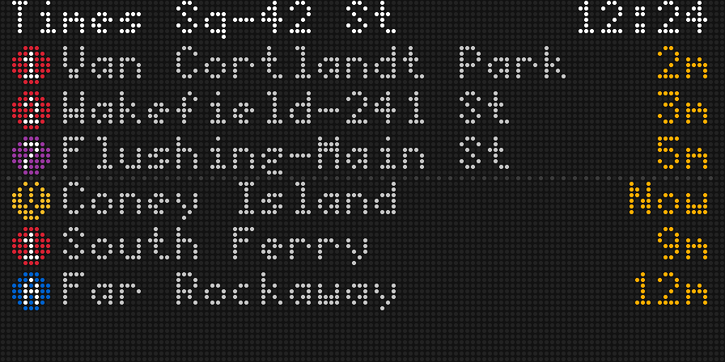

# MTA Tracker

A real-time NYC subway arrival board. Enter a station and see which trains are coming and how many minutes away they are. For now it renders as an ASCII board in the terminal. An LED matrix display is planned.

```
+--------------------------------------------+
| TIMES SQ-42 ST                 12:23:20 AM |
+--------------------------------------------+
| NORTHBOUND                                 |
| (E) Jamaica Center-Parsons/Archer    2 min |
| (2) Wakefield-241 St                 3 min |
| (1) Van Cortlandt Park-242 St        3 min |
| (3) Harlem-148 St                    4 min |
| SOUTHBOUND                                 |
| (Q) Coney Island-Stillwell Av        1 min |
| (A) Far Rockaway-Mott Av             5 min |
| (N) Coney Island-Stillwell Av        8 min |
| (1) South Ferry                      9 min |
+--------------------------------------------+
| Updated 12:23:20 AM                        |
+--------------------------------------------+
```

## Setup

```sh
python -m venv .venv
.venv/Scripts/activate        # Windows; use `source .venv/bin/activate` elsewhere
pip install -r requirements.txt
```

No API key is needed. The MTA's subway GTFS-realtime feeds are public.

## Usage

```sh
python -m mta_tracker
```

This opens a station search. Start typing and the list narrows as you type. The matching is fuzzy, so `tmes sq`, `grand centrl`, `42nd street`, and `bklyn bridge` all work. Words after the first can also name a line, so `86 st q` picks out the Q's 86 St. Station IDs like `127` work too.

```
 MTA STATION SEARCH
 Search: 42 st_
 ----------------------------------------------------------------------------
   5 Av / 42 St-Bryant Pk                                           B D F M 7
 > Times Sq-42 St / 42 St-Port Authority Bus Terminal A C E N Q R W S 1 2 3 7
   Grand Central-42 St                                              S 4 5 6 7
 ----------------------------------------------------------------------------
 3 stations                              Up/Down move  Enter select  Esc quit
```

| Key | Search screen | Arrival board |
| --- | --- | --- |
| Up / Down, PgUp / PgDn, Home / End | Move the selection | |
| Enter | Open the board for the selected station | |
| Backspace, Ctrl+U, Ctrl+W | Delete a character, the whole query, or the last word | Back to search |
| `s`, `/`, Esc | | Back to search, with your query kept |
| `a` | | Add another station; the board rotates through them all |
| Esc | Quit | |
| `q`, Ctrl+C | | Quit |

Other ways to run it:

```sh
python -m mta_tracker union sq             # open the search with "union sq" already typed
python -m mta_tracker union sq -d S -n 6   # southbound only, 6 trains per direction
python -m mta_tracker "1 av" --once        # print one board and exit (no search screen)
```

When stdin or stdout isn't a terminal (piped or scripted), or with `--once`, the station comes from the arguments instead. If that's ambiguous, you get a numbered list to pick from.

| Option | Meaning |
| --- | --- |
| `-a QUERY` | Another station to rotate through after the first; repeat for more. Each station shows its pages of trains in turn. |
| `-d N\|S\|both` | Direction. N is northbound/uptown and S is southbound/downtown, by MTA convention. |
| `-n ROWS` | Trains shown per direction (default 4) |
| `-p SECONDS` | The board alternates between two pages: the soonest trains, then the next ones after them. Each page shows for this many seconds (default 8); `0` shows only the soonest. A direction with no second page keeps showing its first. In the terminal, each direction's title shows `1/2` or `2/2`. |
| `-r SECONDS` | Seconds between data fetches (default 30). The board redraws every second. |
| `-w WIDTH` | Board width in characters |
| `--once` | Render one frame and exit |
| `--no-color` | Plain ASCII, no ANSI route colors |
| `--no-animation` | Turn off animations (split-flap transitions and the fading "Now") |
| `--refresh-stations` | Re-download the static station list |

On first run, the static GTFS schedule (about 6 MB) is downloaded and condensed into `~/.cache/mta_tracker/index.json`. Set `MTA_TRACKER_CACHE` to put it somewhere else. The index is refreshed weekly.

## How it works

- `stops.py` builds the index from the static GTFS. It holds station names, which routes stop at each station (from `stop_times.txt`), and station **complexes**. A complex is a set of stations joined by `transfers.txt`. For example, Times Sq-42 St is five GTFS stations: 127, 725, 902, A27, and R16.
- `feeds.py` fetches the 8 realtime feeds in parallel. After the first poll, it fetches only the feeds that serve the chosen station, and does a full re-scan every 10 minutes.
- `arrivals.py` turns the feeds into a sorted list of `Arrival` objects. Trains that terminate at the station are skipped. The headsign is the name of the trip's last stop.
- `picker.py` and `terminal.py` provide the interactive search screen. Keys are read with `msvcrt` on Windows and `termios` on Linux/macOS, so there are no extra dependencies.
- `display/splitflap.py` animates text changes like a split-flap (Solari) board. When a character changes, it flips forward through a fixed drum of flaps (`... R S T U V`) until it lands on the new character, and changed rows ripple left to right. It works on a grid of character cells, so an LED renderer can reuse it as is. The board opens with a flap-in, and it isn't used with `--once` or when output isn't a terminal.
- A train arriving "Now" fades in and out (a smooth 1.6s cycle). This needs color, so it is off with `--no-color`.
- `display/` holds the renderers. A layout turns a `BoardState` into a grid of `Cell`s tagged with a *semantic* style (`route:A`, `eta`, `now`, `dim`, …; see `display/styles.py`). Each renderer maps those styles to its own colors. `AsciiBoard` maps them to ANSI codes. `LedBoard` maps them to RGB pixels using its own compact layout, bitmap fonts in `display/fonts/`, and filled route bullets. Both share the split-flap animator and the "Now" fade.
- `display/panel.py` describes LED panel geometry (standard module sizes, chaining, pitch, physical size). `display/matrix.py` sends frames to a real panel, to the emulator, or to a PNG.

## LED panel preview

The board can be mirrored to an LED matrix panel. On a PC it's emulated in your browser with realistic round LEDs; on a Raspberry Pi it drives a real panel. The terminal keeps the search screen and its own board, so you can compare the two side by side.



```sh
python -m mta_tracker --led emulator                    # 128x64 at P2.5, opens http://localhost:8888
python -m mta_tracker --led emulator --panel 128x32     # a different standard size
python -m mta_tracker --led emulator --panel 192x64 --pitch P3
python -m mta_tracker --list-panels                     # presets, text grid and physical size per pitch
python -m mta_tracker "times sq" --snapshot board.png   # write one LED-style frame to a PNG and exit
```

**Choosing the panel.** `--panel` picks a whole-display preset:

| Preset | Modules | Text grid (5×7 font) | Size at P2.5 | Size at P3 |
| --- | --- | --- | --- | --- |
| 64x32 | 1× 64×32 | 12 × 4 (uses 4×6 font: 16 × 4) | 160 × 80 mm | 192 × 96 mm |
| 128x32 | 2× 64×32 | 25 × 4 | 320 × 80 mm | 384 × 96 mm |
| 64x64 | 1× 64×64 | 12 × 8 (4×6: 16 × 9) | 160 × 160 mm | 192 × 192 mm |
| **128x64** (default) | 2× 64×64 | **25 × 8** | **320 × 160 mm** | 384 × 192 mm |
| 192x64 | 3× 64×64 | 38 × 8 | 480 × 160 mm | 576 × 192 mm |
| 256x64 | 4× 64×64 | 51 × 8 | 640 × 160 mm | 768 × 192 mm |
| 128x128 | 4× 64×64 (2×2) | 25 × 16 | 320 × 320 mm | 384 × 384 mm |

**Custom arrangements.** `--module` (32x16, 32x32, 64x32, 64x64, 128x64), `--chain` (modules side by side) and `--parallel` (stacked rows) override the preset. They use the same terms as the Pi library's `--led-cols/--led-rows/--led-chain/--led-parallel`.

**Pitch.** `--pitch` takes a standard LED pitch (P1.5 … P10). It sets the physical size, and the emulator and snapshots draw the panel roughly life-size: one screen pixel per 1/96 in. Override that with `--pixel-size`.

**Other options:**
- `--font` (4x6, 5x7, 5x8, 6x10)
- `--brightness`
- `--emulator-style real|circle|square`
- `--emulator-adapter browser|pygame|tkinter|…`
- `--no-browser`

The panel layout is denser than the terminal's. It has a station and clock header, then up to three trains per direction with a dotted rule between them. It flips between two pages of trains like the terminal does; while paging, each train is numbered in arrival order (1-3, then 4-6), and a dot in the train's line color crosses the dotted rule in time with the flip. With several stations, it shows each station's pages in turn. Line bullets are filled circles (diamonds for express trains), and destinations are shortened to fit ("Coney Island-Stillwell Av" → "Coney Island", "34 St-Hudson Yards" → "Hudson Yards"). On panels too small for a header, it shows two trains per direction and draws line letters in the line color.

The emulator is [RGBMatrixEmulator](https://pypi.org/project/RGBMatrixEmulator/), a drop-in for the Pi library's Python API. The settings it needs are written to `~/.cache/mta_tracker/emulator/` on each run, so nothing appears in your working directory.

## Next steps: running on a real panel

The goal is a wall-mounted board that looks like the MTA's platform countdown clocks, run by a Raspberry Pi driving a HUB75 RGB LED matrix. The preview above already uses the same code path as real hardware. The same `MatrixOutput` drives `rgbmatrix` on the Pi, and on the Pi `--led auto` picks the hardware automatically.

**Recommended panel: 128×64**, made from two chained 64×64 modules. At P2.5 it's about 12.6 × 6.3 in, desk-sized; at P3 it's about 15 × 7.5 in, wall-sized. 128×32 is the budget option: a long strip with two trains per direction. Use the same model and pitch for every module in a chain.

### Build guide

**[docs/hardware.md](docs/hardware.md)** is a guided, no-soldering build that teaches the electronics as you go. It covers the parts (Pi 4, Adafruit Triple LED Matrix Bonnet, 2× 64×64 HUB75 panels, a 5 V 10 A supply) and what each one does, the basics of electricity, a power budget, safe wall power, wiring, a measure-before-you-power-on check, Pi setup, running at boot with systemd, and troubleshooting.

### Remaining work

1. **Test on hardware.** Tune `--brightness`, `--gpio-slowdown` and the PWM mapping. Check the frame rate on a Pi 4: frames are drawn into a Pillow image, about 200 glyph pastes per frame.
2. **Choosing a station without a keyboard.** Add a config file, a small web page, or a couple of buttons.
3. **Use the spare row.** The 8th row on 128×64 is free for a status line or a scrolling service-alert ticker.
4. **More realistic flaps.** Since we control pixels, a flip could draw the top half of a cell with the new glyph and the bottom half with the old one, with a dark "hinge" line between them.
5. **Pi 5 support.** Add a Piomatter output to `display/matrix.py`. It takes the same Pillow frame as a numpy framebuffer.
6. **Golden-image tests.** Compare `--snapshot` output against saved PNGs.

## Tests

```sh
python -m pytest
```
